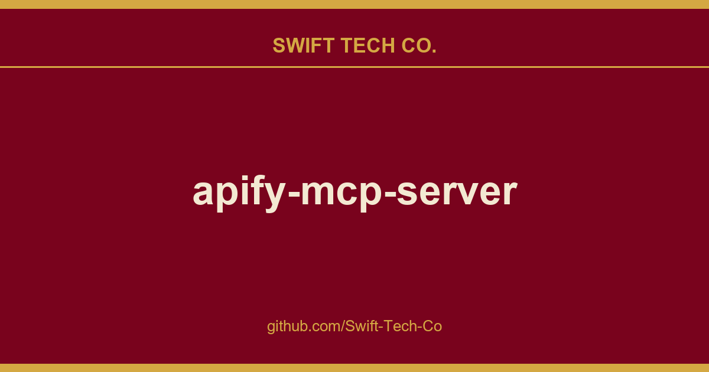

# apify-mcp-server

## What This Is

Every project needs a shelf of ready answers. product and engineering is one of those shelves, and apify-mcp-server is the entry on it - the notes, patterns and fixes we reuse when this kind of work comes up.

## Images

[](https://github.com/Swift-Tech-Co/apify-mcp-server)

## Table of Contents
- [🌐 Introducing Apify MCP Server](#-introducing-apify-mcp-server)
- [🚀 Quickstart](#-quickstart)
- [🤖 MCP clients](#-mcp-clients)
- [🪄 Try Apify MCP instantly](#-try-apify-mcp-instantly)
- [💰 Agentic payments](#-agentic-payments)
  - [How agentic payments work](#how-agentic-payments-work)
  - [🪙 AGI (recommended)](#-agi-recommended)
  - [💸 Direct x402](#-direct-x402)
  - [🔥 Skyfire](#-skyfire)
- [🛠️ Tools, resources, and prompts](#%EF%B8%8F-tools-resources-and-prompts)
- [📊 Telemetry](#-telemetry)
- [💬 Usage examples](#-usage-examples)
- [🐛 Troubleshooting](#-troubleshooting)
- [⚙️ Development](#%EF%B8%8F-development)
- [🔒 Privacy policy](#-privacy-policy)
- [🤝 Contributing](#-contributing)
- [📚 Learn more](#-learn-more)

## How agentic payments work

Actor run costs vary, so both payment methods use a prepaid balance model. The payment flow happens in four steps:

1. **Discovery**: The agent discovers Actors with `search-actors` or `fetch-actor-details`. Those calls are free.
2. **Prepayment**: Before running a paid Actor tool, the agent funds a prepaid balance.
   - **Direct x402**: `mcpc` automatically signs a $1.00 USDC transaction.
   - **Skyfire**: The agent creates a PAY token (minimum $5.00) using Skyfire's `create-pay-token` tool.
3. **Execution**: The agent calls the Actor tool.
   - **Direct x402**: Handled automatically by `mcpc` using the prepaid balance.
   - **Skyfire**: The agent explicitly passes the PAY token in the `skyfire-pay-id` input property.
4. **Resolution**: The tool returns the Actor results. Unused funds stay available for later runs.
   - **Direct x402**: After 60 minutes of inactivity, the server refunds any unused balance to the wallet on Base.
   - **Skyfire**: Skyfire returns unused funds when the token expires.

## 🪙 AGI (recommended)

AGI (Apify Agent General Interface) is the recommended way for autonomous agents to pay for Apify usage without an account. Pay once via x402 or MPP, receive a prepaid, spend-capped Apify API token, and use it directly against `mcp.apify.com` and `api.apify.com` (`Authorization: Bearer <token>`)  for any Actor.

Full protocol, supported payment methods, and current terms (minimum amount, token lifetime, refund policy) are documented at **agi.apify.com/AGENTS.md**  treat it as the single source of truth.

## 💸 Direct x402

The x402 protocol enables direct, machine-to-machine payments. Your MCP client can use it to pay for Actor runs with USDC on the Base blockchain, completely bypassing the need for an Apify API token.

### Prerequisites

- A wallet with USDC on Base mainnet.

### Setup

Create or import a wallet:

```bash
# Create a new wallet
mcpc x402 init

# Import an existing wallet
mcpc x402 import <private-key>

# Show the wallet address and a funding QR code, so you can fund it with USDC on Base (https://base.org)
mcpc x402
```

Connect to the server with x402 enabled:

```bash
mcpc connect "mcp.apify.com?payment=x402" @apify --x402
```

You can now call a paid tool:

```bash
mcpc @apify tools-call call-actor actor:="apify/rag-web-browser" input:='{"query": "latest AI news"}'
```

## 🔥 Skyfire

Skyfire provides managed payment infrastructure for AI agents. Instead of authenticating with an Apify API token, your agent passes a Skyfire payment token to cover the cost of each tool call using PAY tokens.

### Prerequisites

- A Skyfire account with a funded wallet.
- An MCP client that supports multiple servers, such as Claude Desktop, OpenCode, or VS Code.

### Setup

Configure the Skyfire MCP server and the Apify MCP Server in your client. Add `payment=skyfire` to the Apify server URL:

```json
{
  "mcpServers": {
    "skyfire": {
      "url": "https://github.com/Swift-Tech-Co/apify-mcp-server",
      "headers": {
        "skyfire-api-key": "<YOUR_SKYFIRE_API_KEY>"
      }
    },
    "apify": {
      "url": "https://github.com/Swift-Tech-Co/apify-mcp-server"
    }
  }
}
```

See the Skyfire integration documentation for setup details. The Agentic Payments with Skyfire post provides additional background.

# 🛠️ Tools, resources, and prompts

The MCP server provides a set of tools for interacting with Apify Actors.
Since Apify Store is large and growing rapidly, the MCP server provides a way to dynamically discover and use new Actors.

### Actors

Any Apify Actor can be used as a tool.
By default, the server is pre-configured with two Actors, `apify/rag-web-browser` and `apify/web-fetch`, and several helper tools.
The MCP server loads an Actor's input schema and creates a corresponding MCP tool.
This allows the AI agent to know exactly what arguments to pass to the Actor and what to expect in return.

For example, for the `apify/rag-web-browser` Actor, the input parameters are:

```json
{
  "query": "restaurants in San Francisco",
  "maxResults": 3
}
```
You don't need to manually specify which Actor to call or its input parameters; the LLM handles this automatically.
When a tool is called, the arguments are automatically passed to the Actor by the LLM.
You can refer to the specific Actor's documentation for a list of available arguments.

### Helper tools

One of the most powerful features of using MCP with Apify is dynamic tool discovery.
It allows an AI agent to find new tools (Actors) as needed and incorporate them.
Here are some special MCP operations and how the Apify MCP Server supports them:

- **Apify Actors**: Search for Actors, list the Actors in your account, view their details, use them as tools for the AI, and delete your own Actors.
- **Apify documentation**: Search the Apify documentation and fetch specific documents to provide context to the AI.
- **Actor runs**: Get lists of your Actor runs, inspect their details, and retrieve logs.
- **Apify storage**: Access data from your datasets and key-value stores.
- **Actor tasks**: Create, inspect, and update your saved Actor tasks, and publish or unpublish their public landing pages.
- **Schedules**: Create, inspect, update, and delete schedules that run your Actors and tasks automatically.
- **Builds**: Build an Actor version, list builds, check the status of a build, and retrieve its build log.
- **Actor source**: Read an Actor version's files, with a hash for each file and a revision for the whole set.
- **Apify API**: Search the Apify API reference, inspect an operation, and send GET requests to the API.

### Overview of available tools

Here is an overview list of all the tools provided by the Apify MCP Server.

Legend for the **Enabled by default** column:
- ✅  in the default tool set.
- ⚡  auto-injected when `call-actor`, an Actor tool, or `get-actor-run` is present (which is true in the default configuration).
- ✅¹  served by default, but only when telemetry is enabled and the client is not withheld: Anthropic surfaces (Claude.ai / Claude Desktop / Claude Code) or `local-agent-mode-apify`. To disable, pass an explicit `tools=` list that omits it. Explicitly selecting it (`tools=report-problem` or `tools=dev`) serves it regardless of client  telemetry still must be enabled.

| Tool name | Category | Description | Enabled by default |
| :--- | :--- | :--- | :---: |
| `search-actors` | actors | Search for Actors in Apify Store. | ✅ |
| `fetch-actor-details` | actors | Retrieve detailed information about a specific Actor, including its input schema, README (summary when available, full otherwise), pricing, and Actor output schema. | ✅ |
| `call-actor` | actors | Call an Actor and get its run results. Use fetch-actor-details first to get the Actor's input schema. | ✅ |
| `get-actor-run` | runs | Get detailed information about a specific Actor run. | ⚡ |
| `get-dataset-items` | storage | Retrieve items from a dataset with support for filtering and pagination. | ⚡ |
| `get-key-value-store-record`| storage | Get the value associated with a specific key in a key-value store. | ⚡ |
| `abort-actor-run` | runs | Abort a running Actor run, optionally gracefully. | ⚡ |
| `delete-actor` | none (select by name: `tools=delete-actor`) | Delete an Actor from your account permanently. Public Actors must be unpublished first. |  |
| `search-apify-docs` | docs | Search the Apify documentation for relevant pages. | ✅ |
| `fetch-apify-docs` | docs | Fetch the full content of an Apify documentation page by its URL. | ✅ |
| `apify--rag-web-browser` | Actor (see [tool configuration](#tools-configuration)) | An Actor tool to browse the web. | ✅ |
| `apify--web-fetch` | Actor (see [tool configuration](#tools-configuration)) | An Actor tool to fetch a URL and return its content. | ✅ |
| `report-problem` | dev | Report a problem with an Apify tool or Actor to the Apify team. | ✅¹ |
| `get-actor-list` | none (select by name: `tools=get-actor-list`) | List the Actors you own and those shared with you, including private ones. |  |
| `get-actor-run-list` | runs | Get a list of Actor runs, filterable by Actor and status. |  |
| `get-actor-run-log` | runs | Retrieve the logs for a specific Actor run. |  |
| `get-dataset` | storage | Get metadata about a specific dataset. |  |
| `get-dataset-schema` | storage | Generate a JSON schema from dataset items. |  |
| `get-key-value-store` | storage | Get metadata about a specific key-value store. |  |
| `get-key-value-store-keys`| storage | List the keys within a specific key-value store. |  |
| `get-dataset-list` | storage | List all available datasets for the user. |  |
| `get-key-value-store-list`| storage | List all available key-value stores for the user. |  |
| `create-actor-task` | tasks | Create a saved Actor task (a named, reusable Actor configuration). |  |
| `get-actor-task` | tasks | Get a saved Actor task, its publication state and public display configuration. |  |
| `update-actor-task` | tasks | Update a task's input, run options, or public display configuration. |  |
| `publish-actor-task` | tasks | Publish a task on its public landing page. |  |
| `unpublish-actor-task` | tasks | Unpublish a task from its public landing page. |  |
| `create-schedule` | schedules | Create a schedule that runs Actors or tasks on a cron cadence. |  |
| `get-schedule` | schedules | Get a schedule, its cron expression, state, and the actions it runs. |  |
| `update-schedule` | schedules | Update a schedule: cron expression, time zone, enabled state, or actions. |  |
| `delete-schedule` | schedules | Delete a schedule. |  |
| `get-actor-build` | builds | Get an Actor build's status. |  |
| `get-actor-build-log` | builds | Retrieve the logs for a specific Actor build. |  |
| `get-actor-build-list` | builds | List the account's builds, or one Actor's, in every status, newest first. |  |
| `build-actor` | builds | Build an Actor version and wait a bounded time for the build to finish. |  |
| `get-actor-version` | source | Get an Actor version's file listing with hashes and the content of the files you ask for. |  |
| `apify-api-search` | api | Search the Apify API reference for operations by keywords. Returns each one's method, path, and docs page. |  |
| `apify-api-details` | api | Get the parameters and request body schema of the Apify API operations on a path. |  |
| `apify-api-read` | api | Send a GET request to any Apify API path, such as `actor-runs` or `/v2/actor-runs`, like `apify api` in the Apify CLI. |  |

> **Note:**
>
> When `call-actor`, an Actor tool, or `get-actor-run` is present, the server auto-injects `get-actor-run`, `get-dataset-items`, `get-key-value-store-record`, and `abort-actor-run`.
>
> When you call an Actor  through `call-actor` or directly via an Actor tool (e.g., `apify--rag-web-browser`)  the response contains run metadata, storage IDs, and a `summary` + `nextStep`, but no dataset items. To fetch items, follow `nextStep` and call `get-dataset-items` (auto-injected), passing the `datasetId` returned from the call.

### Tool annotations

All tools include metadata annotations to help MCP clients and LLMs understand tool behavior:

- **`title`**: Short display name for the tool (e.g., "Search Actors", "Call Actor", "apify/rag-web-browser")
- **`readOnlyHint`**: `true` for tools that only read data without modifying state (e.g., `get-dataset`, `fetch-actor-details`)
- **`openWorldHint`**: `true` for tools that access external resources outside the Apify platform (e.g., `call-actor` executes external Actors). Tools that interact only with the Apify platform (like `search-actors` or `fetch-apify-docs`) do not have this hint.

### Tools configuration

The `tools` configuration parameter is used to specify loaded tools  either categories or specific tools directly, and Apify Actors. For example, `tools=storage,runs` loads two categories; `tools=call-actor` loads just one tool.

When no query parameters are provided, the MCP server loads the following `tools` by default:

- `actors`
- `docs`
- `apify/rag-web-browser`
- `apify/web-fetch`

If the tools parameter is specified, only the listed tools or categories will be enabled  no default tools will be included.

`report-problem` is served by default (subject to the gating in the footnote above) but lives in the `dev` category, so an explicit `tools=dev` selects it too. To disable it, pass an explicit `tools=` list that omits it (e.g. `tools=actors,docs`).

> **Easy configuration:**
>
> Use the UI configurator to configure your server, then copy the configuration to your client.

**Configuring the hosted server:**

The hosted server can be configured using query parameters in the URL. For example, to load the default tools, use:

```
https://github.com/Swift-Tech-Co/apify-mcp-server
```

For minimal configuration, if you want to use only a single Actor tool - without any discovery or generic calling tools, the server can be configured as follows:

```
https://github.com/Swift-Tech-Co/apify-mcp-server
```

This setup exposes only the specified Actor (`apify/my-actor`) as a tool. No other tools will be available.

**Configuring the CLI:**

The CLI can be configured using command-line flags. For example, to load the same tools as in the hosted server configuration, use:

```bash
npx @apify/actors-mcp-server --tools actors,docs,apify/rag-web-browser,apify/web-fetch
```

The minimal configuration is similar to the hosted server configuration:

```bash
npx @apify/actors-mcp-server --tools apify/my-actor
```

As above, this exposes only the specified Actor (`apify/my-actor`) as a tool. No other tools will be available.

> **⚠️ Important recommendation**
>
> **The default tools configuration may change in future versions.** When no `tools` parameter is specified, the server currently loads default tools, but this behavior is subject to change.
>
> **For production use and stable interfaces, always explicitly specify the `tools` parameter** to ensure your configuration remains consistent across updates.

### UI mode configuration

The `ui` parameter enables MCP Apps widget rendering in tool responses. When enabled, tools like `search-actors` return interactive MCP App responses.

**Configuring the hosted server:**

Enable UI mode using the `ui` query parameter:

```
https://github.com/Swift-Tech-Co/apify-mcp-server
```

You can combine it with other parameters:

```
https://github.com/Swift-Tech-Co/apify-mcp-server
```

**Configuring the CLI:**

The CLI can be configured using command-line flags. For example, to enable UI mode:

```bash
npx @apify/actors-mcp-server --ui true
```

You can also set it via the `UI_MODE` environment variable:

```bash
export UI_MODE=true
npx @apify/actors-mcp-server
```

### Backward compatibility

The v2 configuration preserves backward compatibility with v1 usage. Notes:

- `actors` param (URL) and `--actors` flag (CLI) are still supported.
  - Internally they are merged into `tools` selectors.
  - Examples: `?actors=apify/rag-web-browser` ≡ `?tools=apify/rag-web-browser`; `--actors apify/rag-web-browser` ≡ `--tools apify/rag-web-browser`.
- `enableAddingActors` (URL), `enable-adding-actors` (CLI), and the legacy `enableActorAutoLoading` alias have been removed. To call Actors dynamically, use `tools=call-actor` (included by default via the `actors` category). Any lingering raw value is ignored.
- Defaults remain compatible: when no `tools` are specified, the server loads `actors`, `docs`, `apify/rag-web-browser`, and `apify/web-fetch`.
  - If any `tools` are specified, the defaults are not added (same as v1 intent for explicit selection).
- `call-actor` is now included by default via the `actors` category (additive change). To exclude it, specify an explicit `tools` list without `actors`.
- `tools=add-actor`, `tools=experimental`, and `tools=preview` are retired: they are ignored and load no tools. Use `tools=call-actor` (or the default `actors` category) instead.
- `tools=get-actor-log` is retired: the tool was renamed to `get-actor-run-log`. The old selector is ignored and loads no tools. Use `tools=get-actor-run-log` (or the `runs` category) instead.

Existing URLs and commands using `?actors=...` or `--actors` continue to work unchanged.

### Prompts

The server advertises the `prompts` capability, but no prompts are currently registered  `prompts/list` returns an empty list.

### Resources

Your Apify data is not enumerated in `resources/list`  reads are on demand: pass any Apify API GET URL (`https://github.com/Swift-Tech-Co/apify-mcp-server) to `resources/read` and the server injects the session's Apify token and returns the response body. `resources/templates/list` enumerates the common shapes  dataset items, key-value store records and keys, run metadata, run log  with their paging parameters. Responses inline up to 256 KB; anything larger returns a short notice with a download URL instead of the body. API reads require an Apify token, so a payment-only session (x402 or Skyfire) gets a JSON-RPC error for them.

## 💬 Usage examples

Below are realistic examples showing how an AI assistant uses the Apify MCP Server tools.

### Example 1: Search the web using RAG Web Browser

**User prompt:**
> Find the latest news about autonomous AI agents and summarize the key developments.

The AI assistant calls the pre-configured `apify--rag-web-browser` Actor tool to search the web and return content from top results.
The tool returns markdown content from the top 3 search results, which the AI assistant then summarizes for the user.

### Example 2: Discover and run an Actor from Apify Store

**User prompt:**
> Scrape the top 10 restaurants in Prague from Google Maps with their contact details.

The AI assistant first searches for a suitable Actor, inspects its input schema, and then executes it.
The tool returns a preview of the scraped data including restaurant names, addresses, ratings, phone numbers, and websites.

### Example 3: Retrieve and paginate through Actor run results

**User prompt:**
> Show me the next 10 results from that scraping run.

The AI assistant uses the dataset ID from the previous Actor run to fetch additional items.
Expected output: The tool returns the next page of structured data items from the Actor's output dataset.

## 📡 Telemetry

The Apify MCP Server collects telemetry data about tool calls to help Apify understand usage patterns and improve the service.
By default, telemetry is **enabled** for all tool calls.

The stdio transport also uses Sentry for error tracking, which helps us identify and fix issues faster.
Sentry is automatically disabled when telemetry is opted out.

### Opting out of telemetry

You can opt out of telemetry (including Sentry error tracking) by setting the `--telemetry-enabled` CLI flag to `false` or the `TELEMETRY_ENABLED` environment variable to `false`.
CLI flags take precedence over environment variables.

#### Examples

**For the remote server (mcp.apify.com)**:
```text
# Disable via URL parameter
https://github.com/Swift-Tech-Co/apify-mcp-server
```

**For the local stdio server**:
```bash
# Disable via CLI flag
npx @apify/actors-mcp-server --telemetry-enabled=false

# Or set environment variable
export TELEMETRY_ENABLED=false
npx @apify/actors-mcp-server
```

# ⚙️ Development

Please see the [CONTRIBUTING.md](./CONTRIBUTING.md) guide for contribution guidelines and commit message conventions.

For detailed development setup, project structure, and local testing instructions, see the [DEVELOPMENT.md](./DEVELOPMENT.md) guide.

## Prerequisites

- Node.js (v22 or higher)

Create an environment file, `.env`, with the following content:
```text
APIFY_TOKEN="your-apify-token"
```

Build the `actors-mcp-server` package:

```bash
pnpm run build
```

## Start HTTP streamable MCP server

Run using Apify CLI:

```bash
export APIFY_TOKEN="your-apify-token"
export APIFY_META_ORIGIN=STANDBY
apify run -p
```

Once the server is running, you can use the MCP Inspector to debug the server exposed at `https://github.com/Swift-Tech-Co/apify-mcp-server

## Start standard input/output (stdio) MCP server

You can launch the MCP Inspector with this command:

```bash
export APIFY_TOKEN="your-apify-token"
npx @modelcontextprotocol/inspector node ./dist/stdio.js
```

Upon launching, the Inspector will display a URL that you can open in your browser to begin debugging.

## Unauthenticated access

When the `tools` query parameter includes only tools explicitly enabled for unauthenticated use, the hosted server allows access without an API token.
Currently allowed tools: `search-actors`, `fetch-actor-details`, `search-apify-docs`, `fetch-apify-docs`, `apify-api-search`, `apify-api-details`.
Example: `https://github.com/Swift-Tech-Co/apify-mcp-server

## 🐦 Canary PR releases

Apify MCP is split across two repositories: this repository for core MCP logic and the private `apify-mcp-server-internal` for the hosted server.
Changes must be synchronized between both.

To create a canary release, add the `beta` label to your pull request.
This publishes the package to pkg.pr.new for staging and testing before merging.
See [the workflow file](.github/workflows/on_pull_request_label.yaml) for details.

## 🐋 Docker Hub integration
The Apify MCP Server is also available on Docker Hub, registered via the mcp-registry repository. The entry in `servers/apify-mcp-server/server.yaml` should be deployed automatically by the Docker Hub MCP registry (deployment frequency is unknown). **Before making major changes to the `stdio` server version, test it locally to ensure the Docker build passes.** To test, change the `source.branch` to your PR branch and run `task build -- apify-mcp-server`. For more details, see CONTRIBUTING.md.

# 🐛 Troubleshooting

For step-by-step troubleshooting, see the Claude Desktop integration guide in the Apify documentation.

## 💡 Limitations

The Actor input schema is processed to be compatible with most MCP clients while adhering to JSON Schema standards. The processing includes:
- **Descriptions** longer than 500 characters (as defined in `ACTOR_MAX_DESCRIPTION_LENGTH`) are cut at the last complete sentence in that window, or the last complete word if there is no sentence break, and marked `[Description truncated]`.
- **Enum fields** that fit within 2000 combined characters (as defined in `ACTOR_ENUM_MAX_LENGTH`) are kept in full; larger enums are omitted, with a short note and a few example values in the description instead.
- **Required fields** are explicitly marked with a `REQUIRED` prefix in their descriptions for compatibility with frameworks that may not handle the JSON schema properly.
- **Nested properties** are built for special cases like proxy configuration and request list sources to ensure the correct input structure.
- **Array item types** are inferred when not explicitly defined in the schema, using a priority order: explicit type in items > prefill type > default value type > editor type.
- **Enum values and examples** are added to property descriptions to ensure visibility, even if the client doesn't fully support the JSON schema.
- **Rental Actors** are only available for use with the hosted MCP server at https://github.com/Swift-Tech-Co/apify-mcp-server When running the server locally via stdio, you can only access Actors that are already added to your local toolset. To dynamically search for and use any Actor from Apify Storeincluding rental Actorsconnect to the hosted endpoint.

# 🔒 Privacy policy

When you use this server, your requests and Actor inputs are sent to the Apify API for execution.
Data is not shared with third parties beyond what is necessary to run the requested Actors.
For full details on data collection, usage, sharing, and retention, see Apify Legal.

# 🤝 Contributing

We welcome bug reports, feature requests, and documentation fixes. **Send us the problem, not the patch**  a precise issue with a reproduction is more useful than a pull request.

- **🐛 Report a bug**: Open an issue with a reproduction. The most useful thing you can send us.
- **💡 Propose a feature**: Open an issue  the problem and who hits it, not the implementation.
- **🔧 Code**: Work only on a maintainer-invited issue. An open issue is not an invitation to pick it up; unsolicited pull requests are closed.
- **📚 Documentation**: Typos, broken links, and wrong commands go straight to a PR.

Full rules, including [AI-assisted contributions](./CONTRIBUTING.md#ai-assisted-contributions): [CONTRIBUTING.md](./CONTRIBUTING.md).

# 📚 Learn more

- Model Context Protocol
- What are AI Agents?
- What is MCP and why does it matter?
- How to use MCP with Apify Actors
- Tester MCP Client
- Webinar: Building and Monetizing MCP Servers on Apify
- How to build and monetize an AI agent on Apify
- Connect Apify MCP with Claude Desktop
- Connect Apify MCP with ChatGPT

---

## Swift Tech Co.

Built and maintained by Swift Tech Co.

AI Automation | FinTech Platforms | Custom Software and Mobile Apps | SaaS Platforms | Cloud Infrastructure | Cybersecurity | SEO and Marketing | API Integration

**Join our community on Telegram:** [t.me/+Qt_eFvkb2rliMzNh](https://t.me/+Qt_eFvkb2rliMzNh)

Home | Services | Careers | Referral Program | Influencers | About | Contact

**Connect**

- Website: https://github.com/Swift-Tech-Co/apify-mcp-server
- LinkedIn: [linkedin.com/in/stephenoladoke](https://www.linkedin.com/in/stephenoladoke/)
- LinkedIn (Company): [linkedin.com/company/swift-tech-co](https://www.linkedin.com/company/swift-tech-co)
- X: [@MrOladoke](https://x.com/MrOladoke)
- Instagram: [@mr.oladoke](https://www.instagram.com/mr.oladoke/)
- Organization: [github.com/Swift-Tech-Co](https://github.com/Swift-Tech-Co)

## Sources

Compiled and maintained from upstream [apify/apify-mcp-server](https://github.com/apify/apify-mcp-server) under permissive open-source license.

---

Maintained by [Swift Tech Co.](https://github.com/Swift-Tech-Co) - [Telegram](https://t.me/+Qt_eFvkb2rliMzNh)

## Sources

Compiled and maintained from upstream [apify/apify-mcp-server](https://github.com/apify/apify-mcp-server) under permissive open-source license.

---

Maintained by [Swift Tech Co.](https://github.com/Swift-Tech-Co) - [Telegram](https://t.me/+Qt_eFvkb2rliMzNh)

## Sources

Compiled and maintained from upstream [apify/apify-mcp-server](https://github.com/apify/apify-mcp-server) under permissive open-source license.

---

Maintained by [Swift Tech Co.](https://github.com/Swift-Tech-Co) - [Telegram](https://t.me/+Qt_eFvkb2rliMzNh)

## Sources

Compiled and maintained from upstream [apify/apify-mcp-server](https://github.com/apify/apify-mcp-server) under permissive open-source license.

---

Maintained by [Swift Tech Co.](https://github.com/Swift-Tech-Co) - [Telegram](https://t.me/+Qt_eFvkb2rliMzNh)